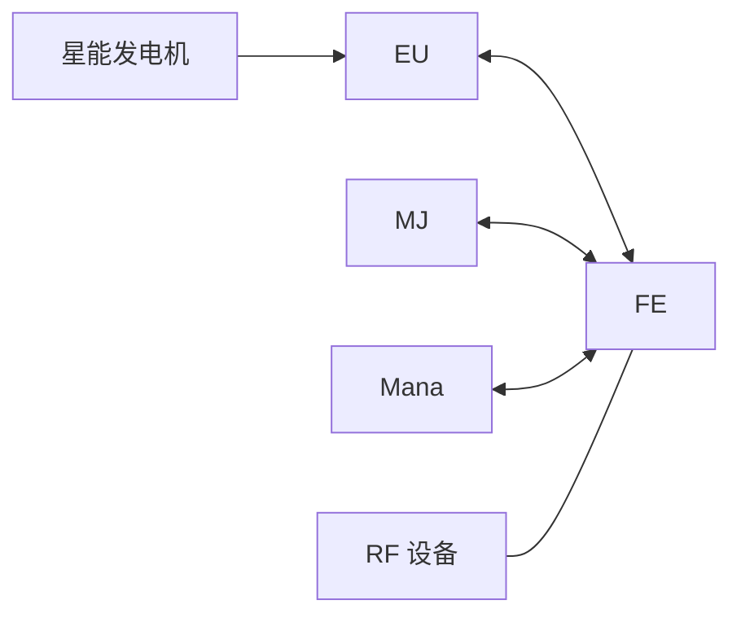

# ICMJ-Core · 整活核心

**Industrial Convergence: Mana Joules**

Minecraft 1.12.2 / Forge / Java 8 的能源兼容模组。以 FE 为统一接口，让 EU、RF、BuildCraft MJ 和 Botania Mana 双向互通，并提供星能发电机。

当前版本：**0.1.5**。游戏内模组 ID 为 `zhenghuocore`，构建产物名为 `zhenghuo-core`。

## 功能

- **EU ↔ FE/RF**：兼容设备作为电源／负载进入新 EU 电网，原生 EU 设备通过电网的同步接口收发 FE。
- **MJ ↔ FE/RF**：接入 BuildCraft 原生能源接口，沿用设备的方向、红石和抽取规则。
- **Mana ↔ FE/RF**：魔力池、发射器等设备可与 FE 互通；兼容设备可接收原生魔力脉冲和火花传输。
- **星能 → EU**：星能发电机收集自然星能或聚能水晶传来的星能，生成 EU。
- **电压与电流配置**：非原生 EU 设备默认 IV／1 A，支持按方块 ID 设置等级和输出电流。



兼容层不增加隐藏储能。满载或接口不能接收时拒收；无法完整换算的余量留在原设备。能源设备发现使用生命周期与端口变化通知。

## 运行依赖

必需：Minecraft **1.12.2**、Forge **14.23.5.2864**（也验证过 2860）、Java **8**、IC2 Experimental **2.8.222-ex112**、提供同步能源入口的新电网 **ic2grid 0.5.1 或兼容版本**。

可选：BuildCraft Community、Botania、Astral Sorcery、The One Probe、Flux Networks。对应模组不存在时不加载其适配。星能发电机需要 Astral Sorcery；TOP 可显示其 EU 储量及输出。

普通 IC2 本体不能替代 `ic2grid` 依赖。第三方模组及定制依赖不随本仓库分发。

## 能量与星能配置

首次运行会生成 `config/zhenghuocore.cfg`，修改后重启生效。

| 配置项 | 默认值 | 含义 |
| --- | --- | --- |
| `conversion.rfPerEu` | 4 | 每 EU 对应的 FE/RF |
| `conversion.rfPerMj` | 40 | 每 MJ 对应的 FE/RF |
| `conversion.rfPerMana` | 10 | 每 Mana 对应的 FE/RF |
| `starlight.euPerStarlight` | 8 | 每单位星能产生的 EU |
| `starlight.outputVoltage` | 8192 | 星能发电机输出电压上限，V |
| `starlight.outputCurrent` | 4 | 星能发电机输出电流上限，A |

默认 **1 MJ = 40 FE/RF = 10 EU = 4 Mana**。换算比例双向共用。

自然星能和水晶星能共用发电倍率，发电量受实际星能和剩余储能空间影响。星能发电机默认储能 250000 EU，输出上限 8192 V × 4 A；修改 FE/EU 比例不会缩放已有 EU 储量。

## 设备电压等级与输出电流

`config/zhenghuocore-voltage.json` 首次生成默认 IV、1 A 和空白名单。以下是配置示例：

```json
{
  "defaultTier": "IV",
  "whitelist": {
    "minecraft:redstone_block": "HV",
    "botania:pool": "HV"
  },
  "defaultCurrent": 1,
  "currentWhitelist": {
    "botania:pool": 2
  }
}
```

- `defaultTier`：非原生 EU 设备的默认输入耐压和 EU 输出电压上限。
- `whitelist`：按方块注册 ID 覆盖等级，格式为 `"modid:block":"HV"`。
- `defaultCurrent`：默认输出电流，单位 A，使用正整数。
- `currentWhitelist`：按方块注册 ID 覆盖输出电流。

上述魔力池的上限为 HV／2 A，即 512 V × 2 A。任一白名单中的方块物品增加 `电压等级:HV` 工具提示。红石块条目仅演示格式，不会赋予普通方块能源接口。同 ID 的不同元数据使用同一设置。

等级名称依次为 **ULV、LV、MV、HV、EV、IV、LuV、ZPM、UV、UHV、UEV、UIV、UXV、OpV、MAX**，从 8 V 起每级乘 4。LV=32 V、MV=128 V、HV=512 V、IV=8192 V。等级名不区分大小写；配置错误会报告文件和条目。

源按可用能量准备整数报价：`I = 配置电流`，`U = min(等级上限, floor(可用 EU / I))`。默认 IV／1 A 最多报价 8192 EU/t；低于最小整数份额时不输出，余量留源。显式设置 IV／2 A 后，8194 EU 可报价 4097 V × 2 A。经 Mana 适配时还需满足整数 Mana 步进，实际派发由 EU 电网调度。

设置只应用于非原生 EU 兼容设备。原生 EU 接口和星能发电机使用各自的输出设置。FE 同步调用不提供调用方方块 ID，使用默认设置；按 ID 覆盖由实际接入 EU 电网的兼容端点应用。原生 FE、MJ、Mana 直接传输沿用原接口。

修改后重启；客户端与服务器使用相同配置，以使工具提示一致。旧 `eu.euTier` 数字配置已退休。

## 从源码构建

需要 Java 8。Gradle wrapper 已包含在仓库内，依赖、开发缓存和游戏测试目录不提交。

将以下固定依赖放入本地 `vendor/`，文件名与 `build.gradle` 中的本地坐标对应：

- `industrialcraft-2-2.8.222-ex112.jar` 及 `industrialcraft-2-2.8.222-ex112-api.jar`
- `ic2grid-0.5.1.jar`
- `buildcraft-8.0.1-robots.1.jar`
- `botania-1.10-364.4.jar`、`baubles-1.5.2.jar`
- `astralsorcery-1.10.27.jar`
- `theoneprobe-1.4.28.jar`

开发访问配置 `vendor/development_at.cfg` 由 Botania 的 `META-INF/botania_at.cfg` 和 Astral Sorcery 的 `META-INF/astralsorcery_at.cfg` 合并得到。它只用于开发映射，不打入产品 JAR。

完整单元测试还会读取 `vendor/fluxnetworks-4.1.1.34-patched.jar` 的实际字节码。开发客户端验证使用 `cyclic-1.20.14.jar`，加 `-PpackMana` 时另需 `botaniatweaks-1.9.1.jar`；真实设备集成测试需要准备对应模组环境。

PowerShell（将 `JAVA_HOME` 指向 Java 8）：

```powershell
.\scripts\gradle.ps1 -JavaHome $env:JAVA_HOME -GradleArguments @('test', 'build')
```

也可使用标准 wrapper：

```sh
./gradlew --gradle-user-home .gradle-user-home test build
```

完整依赖缓存可用时可追加 `--offline -x downloadMCMeta`。输出为 `build/libs/zhenghuo-core-0.1.5.jar`；测试夹具不进入该 JAR。`validationJar` 任务单独打包开发测试模组。

## 开发接口说明

EU 适配使用 IC2 EnergyNet 与 ic2grid 公开的收发、方向、预算和储量接口。对 BuildCraft、Botania 与 Flux 的字节码接入集中在 `CompatibilityTransformer`。

动态 FE 设备改变端口时应发送方块／邻居通知，或调用 `CompatibilityEvents.connectionsChanged(world, pos)`，让兼容端点局部更新。真实设备与能源读写在服务端主线程进行。
